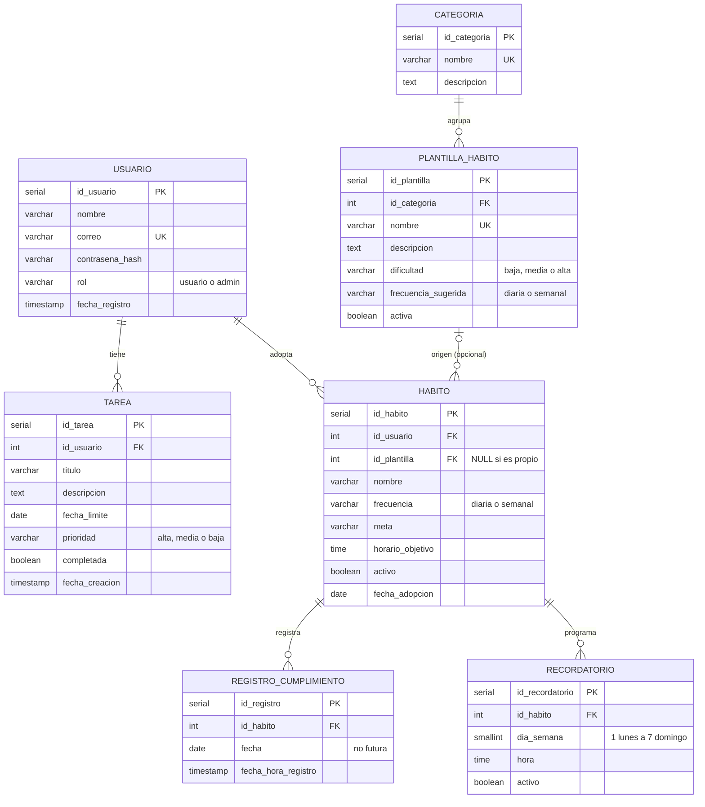

# GesHab — Gestión de hábitos saludables y tareas

Aplicación web y móvil para organizar tareas personales y construir hábitos
saludables, con registro diario de cumplimiento, rachas y un catálogo de
hábitos mantenido por un administrador.

Esta es la rama **`backend`**: contiene la API REST en Node.js, Express y
TypeScript sobre PostgreSQL. El cliente Ionic + React está en la rama
[`frontend`](https://github.com/Klonmah/ing-web-gestion-habitos/tree/frontend).

---

## Integrantes y responsabilidades

| Integrante | Rol | Responsabilidad |
|---|---|---|
| Ignacio Reyes Torres | A | Base de datos (`backend/database/geshab.sql`) y documentación |
| Gabriel Martínez Oyarce | B | Servidor, autenticación JWT y seguridad |
| Matías Labra Concha | C | CRUD de usuario (tareas, hábitos, registros, progreso) y pruebas |
| Martín Díaz Valle | D | CRUD de administración e integración con el frontend |

---

## El problema

Mantener un hábito falla casi siempre por lo mismo: la constancia no se ve.
Las personas abandonan porque no tienen a la vista cuánto llevan ni qué
rompieron, y porque registrar el avance cuesta más que el hábito mismo.

GesHab aborda las dos cosas: el registro de un cumplimiento toma dos
interacciones desde la pantalla principal, y el progreso se muestra como
racha de días consecutivos y porcentaje semanal y mensual.

El sistema tiene dos roles. El **usuario** gestiona sus propias tareas y
hábitos, y su experiencia es individual. El **administrador** mantiene el
catálogo de hábitos saludables y sus categorías, y nunca accede a los datos
personales de nadie: sus métricas son agregadas y anónimas.

---

## Arquitectura

```
Frontend (Ionic + React)          Backend (Express + TypeScript)
   src/services/api.ts   ──HTTP──▶   src/routes
                                        │
                                     src/middlewares   (JWT, rol, validación)
                                        │
                                     src/controllers
                                        │
                                     src/services      (lógica y SQL)
                                        │
                                     PostgreSQL
```

Las capas están separadas de forma que el controlador no escribe SQL y el
servicio no conoce HTTP. El frontend no importa código del backend: ambos se
comunican únicamente por la API REST.

### Estructura del repositorio

Esta rama contiene solo la API. El frontend (Ionic + React) está en la rama `frontend`.

```
backend/
├── database/geshab.sql     Script reproducible de la base
├── src/
│   ├── config/             Pool de conexiones a PostgreSQL
│   ├── routes/             Qué URL corresponde a qué controlador
│   ├── controllers/        Leen el request y arman la respuesta
│   ├── services/           Lógica de negocio y consultas SQL
│   ├── middlewares/        JWT, rol admin, validación, errores
│   ├── schemas/            Reglas de validación con zod
│   ├── types/              Extensión del tipo Request de Express
│   └── utils/              ErrorHttp, ayudas de PostgreSQL
├── Dockerfile
└── package.json
anexos/                     Colección de Postman, reporte de newman y capturas
docker-compose.yml          Base de datos + API con un solo comando
docker-env.example          Variables para Docker
```

---

## Requisitos previos

- Node.js 18 o superior
- PostgreSQL 14 o superior, con `psql` disponible en la terminal
- Git

Para el despliegue con contenedores basta con Docker; no hace falta instalar
Node ni PostgreSQL.

---

## Opción A: despliegue con Docker (recomendado)

Levanta PostgreSQL y la API con un solo comando. La base se crea y se puebla
sola con `backend/database/geshab.sql` la primera vez.

```bash
git clone -b backend https://github.com/Klonmah/ing-web-gestion-habitos.git
cd ing-web-gestion-habitos

cp docker-env.example .env      # completar JWT_SECRET
docker compose up --build
```

La API queda en `http://localhost:3000` y PostgreSQL en el puerto 5432.
Para comprobarlo: `http://localhost:3000/salud`.

Para detener los contenedores y borrar también los datos:

```bash
docker compose down -v
```

---

## Opción B: instalación local

Todos los comandos se ejecutan desde la carpeta `backend/`.

### 1. Clonar el repositorio en la rama `backend`

```bash
git clone -b backend https://github.com/Klonmah/ing-web-gestion-habitos.git
cd ing-web-gestion-habitos/backend
```

### 2. Crear la base de datos

El script crea la base `geshab` desde cero: tablas, claves, restricciones,
índices y datos de prueba. Si la base ya existe, la borra y la vuelve a
crear, por lo que se puede ejecutar las veces que sea necesario.

```bash
psql -U postgres -f database/geshab.sql
```

> En Windows, si `psql` no se reconoce, hay que agregar la carpeta `bin` de
> PostgreSQL (por ejemplo `C:\Program Files\PostgreSQL\18\bin`) a la variable
> de entorno `Path` y reiniciar la terminal.

### 3. Configurar las variables de entorno

```bash
cp .env.example .env
```

| Variable | Descripción | Ejemplo |
|---|---|---|
| `PORT` | Puerto del servidor | `3000` |
| `DB_HOST` | Host de PostgreSQL | `localhost` |
| `DB_PORT` | Puerto de PostgreSQL | `5432` |
| `DB_NAME` | Nombre de la base | `geshab` |
| `DB_USER` | Usuario de PostgreSQL | `postgres` |
| `DB_PASSWORD` | Contraseña de ese usuario | — |
| `JWT_SECRET` | Clave de firma de los tokens (larga y aleatoria) | — |
| `JWT_EXPIRES_IN` | Duración del token (RNF-02) | `24h` |
| `CORS_ORIGIN` | Orígenes del frontend autorizados, separados por coma | `http://localhost:5173,http://localhost:8100` |

El archivo `.env` está en `.gitignore` y **nunca** se sube al repositorio.
Cada integrante crea el suyo con su propia contraseña de PostgreSQL.

Para generar un `JWT_SECRET`:

```bash
node -e "console.log(require('crypto').randomBytes(48).toString('hex'))"
```

### 4. Instalar dependencias

```bash
npm install
```

---

## Seguridad implementada

| Medida | Dónde |
|---|---|
| Contraseñas con bcrypt (10 rondas) | `src/services/auth.service.ts` |
| Reglas de contraseña: 8 caracteres, una mayúscula y un número | `src/schemas/auth.schema.ts` |
| JWT firmado con expiración de 24 h (RNF-02) | `src/services/auth.service.ts` |
| Rutas protegidas y guard de rol (401 / 403) | `src/middlewares/auth.middleware.ts` |
| Validación de entrada con zod | `src/middlewares/validar.middleware.ts` |
| Consultas parametrizadas contra inyección SQL | Toda la capa de servicios |
| Errores sin filtrar detalles internos | `src/middlewares/error.middleware.ts` |
| Cabeceras de seguridad con helmet y `X-Powered-By` desactivado | `src/index.ts` |
| Límite de 15 intentos fallidos por IP cada 15 min en `/api/auth` (los exitosos no cuentan) | `src/index.ts` |
| Validación de fechas reales (`2026-02-31` se rechaza), ids, horas y JSON malformado: 400, nunca 500 | `src/schemas/`, `src/middlewares/` |
| Secretos fuera del repositorio (`.env` en `.gitignore`) | — |

El registro público siempre crea cuentas con rol `usuario`: el campo `rol` no
se acepta en el body y la base lo fija por defecto. El rol `admin` se asigna
directamente en la base de datos.

---

## Ejecución

```bash
npm run dev
```

El servidor queda en `http://localhost:3000`. Para revisar que esté conectado a la base se puede abrir `http://localhost:3000/salud`, que debería responder `"estado": "ok"`.

### Endpoints

Todas las rutas empiezan con `/api`. Las que dicen Usuario o Admin necesitan el token que devuelve el login, enviado en el header `Authorization: Bearer <token>`.

| Método | Ruta | Acceso | Qué hace |
|---|---|---|---|
| POST | `/api/auth/registro` | Público | Crea una cuenta nueva (siempre con rol usuario) |
| POST | `/api/auth/login` | Público | Inicia sesión y devuelve el token |
| GET | `/api/auth/perfil` | Usuario | Datos del usuario que inició sesión |
| GET, POST | `/api/tareas` | Usuario | Listar y crear tareas (RF-01) |
| PUT, DELETE | `/api/tareas/:id` | Usuario | Editar y borrar una tarea |
| GET, POST | `/api/habitos` | Usuario | Listar y crear hábitos (RF-02) |
| PUT, DELETE | `/api/habitos/:id` | Usuario | Editar y borrar un hábito |
| POST | `/api/habitos/:id/cumplimientos` | Usuario | Marcar un hábito como cumplido (RF-03) |
| GET, POST | `/api/registros` | Usuario | Listar y crear registros de cumplimiento |
| PUT, DELETE | `/api/registros/:id` | Usuario | Editar y borrar un registro |
| GET | `/api/progreso?periodo=semanal` | Usuario | Porcentaje de cumplimiento y rachas, por hábito, por categoría y general (RF-04). También acepta `mensual` |
| GET, POST | `/api/recordatorios` | Usuario | Listar (filtro opcional `?id_habito=`) y crear recordatorios (RF-05) |
| PUT, DELETE | `/api/recordatorios/:id` | Usuario | Editar y borrar un recordatorio |
| GET | `/api/catalogo?categoria=&dificultad=` | Usuario | Plantillas activas con filtros (RF-06) |
| GET, POST | `/api/admin/plantillas` | Admin | Listar y crear plantillas (RF-07) |
| PUT, DELETE | `/api/admin/plantillas/:id` | Admin | Editar y borrar plantillas (no se puede borrar si alguien la adoptó) |
| GET, POST | `/api/admin/categorias` | Admin | Listar y crear categorías (RF-08) |
| PUT, DELETE | `/api/admin/categorias/:id` | Admin | Editar y borrar categorías |
| GET | `/api/admin/metricas` | Admin | Métricas generales sin datos personales (RF-08) |

Si no se manda el token la respuesta es 401, y si un usuario normal intenta entrar a `/api/admin` la respuesta es 403.

### Formato de errores

Todos los errores de la API responden con el mismo formato. Cuando el problema es un dato enviado, `detalles` indica qué campo falló:

```json
{
  "error": "Los datos enviados no son validos",
  "detalles": [{ "campo": "fecha_limite", "mensaje": "La fecha no existe en el calendario" }]
}
```

| Código | Cuándo |
|---|---|
| 400 | Dato inválido: fecha con formato malo o inexistente (`hola`, `2026-02-31`), id no numérico (`/tareas/abc`), JSON malformado, plantilla inexistente, fecha de cumplimiento futura |
| 401 / 403 | Sin token, token vencido o sin rol admin |
| 404 | El recurso no existe o no pertenece al usuario |
| 409 | Conflicto: adoptar dos veces la misma plantilla, adoptar una plantilla desactivada, marcar dos veces el mismo día, recordatorio repetido |
| 429 | Demasiados intentos fallidos de login o registro |

### Notas sobre los endpoints

- **PUT parcial.** En tareas, hábitos, registros y recordatorios el `PUT` actualiza solo los campos que se envían (por ejemplo `{ "titulo": "..." }` sin `completada`). Un body vacío responde 400.
- **Adopción (RF-06).** `POST /api/habitos` con `id_plantilla` adopta una plantilla del catálogo. Debe existir y estar activa, y cada usuario puede adoptarla una sola vez.
- **Recordatorios (RF-05).** Body: `{ "id_habito": 1, "dia_semana": 1, "hora": "08:00", "activo": true }`, con `dia_semana` de 1 (lunes) a 7 (domingo). El hábito debe ser del usuario.
- **Progreso (RF-04).** El servidor calcula los porcentajes. Por cada hábito activo devuelve `racha_actual`, `cumplimientos_periodo`, `cumplidos`, `esperados`, `porcentaje` y `categoria`. Además entrega `categorias[]` y `porcentaje_general`. La regla es la siguiente:
  - Un hábito diario espera un cumplimiento por día y uno semanal, uno por semana.
  - Solo cuentan los días desde que se adoptó el hábito.
  - El porcentaje tiene tope de 100.
  - Los hábitos sin plantilla quedan en la categoría "Personalizados".

Para levantar también el frontend, en otra terminal y en la rama `frontend`:

```bash
npm install
ionic serve
```


---

## Usuarios de prueba

Los crea `database/geshab.sql`. **Solo para desarrollo.**

| Correo | Contraseña | Rol |
|---|---|---|
| admin@geshab.cl | Admin1234 | admin |
| ana@geshab.cl | Usuario123 | usuario |
| benja@geshab.cl | Usuario123 | usuario |
| carla@geshab.cl | Usuario123 | usuario |

---

## Modelo relacional




### Relaciones

| Relación | Tipo | Qué pasa si se borra el padre |
|---|---|---|
| usuario → tarea | 1 a N | CASCADE |
| usuario → habito | 1 a N | CASCADE |
| categoria → plantilla_habito | 1 a N | RESTRICT |
| plantilla_habito → habito | 1 a N (opcional) | RESTRICT |
| habito → registro_cumplimiento | 1 a N | CASCADE |
| habito → recordatorio | 1 a N | CASCADE |

Usamos CASCADE en lo que es de cada usuario: si se borra una cuenta, se borran también sus tareas, hábitos, cumplimientos y recordatorios, ya que ya no le serviríoa a nadie más.

Usamos RESTRICT en el catálogo, así la base no deja borrar una plantilla que algún usuario ya adoptó (esto es lo que pide RF-07), ni una categoría que todavía tenga plantillas.

En `habito`, la columna `id_plantilla` puede ser NULL. Si el hábito viene del catálogo apunta a su plantilla, y si el usuario lo creó desde cero queda en NULL. Así los dos casos de RF-02 caben en una sola tabla.

### Restricciones

- El correo de cada usuario es único y tiene que tener formato de correo.
- El rol solo puede ser `usuario` o `admin`, y por defecto es `usuario`.
- Un usuario no puede adoptar dos veces la misma plantilla.
- Un hábito no se puede marcar dos veces el mismo día. Esto evita que alguien infle su racha.
- La fecha de un cumplimiento no puede ser futura.
- En los recordatorios, `dia_semana` va de 1 (lunes) a 7 (domingo).
- La racha no se guarda en ninguna tabla, el backend la calcula con los registros de cumplimiento.

### Índices

Para cumplir RNF-01 (que los hábitos del día carguen en menos de 2 segundos) agregamos índices en las columnas que más se usan para filtrar:

- `tarea (id_usuario)`
- `habito (id_usuario)`
- `registro_cumplimiento (id_habito, fecha DESC)`
- `plantilla_habito (id_categoria)`
- `recordatorio (dia_semana, hora)`, solo para los recordatorios activos

### Pruebas de las restricciones

Al final de `database/geshab.sql` dejamos comentadas cuatro pruebas para correr a mano en `psql`. Las tres primeras tienen que dar error:

| Prueba | Qué debería pasar |
|---|---|
| Marcar dos veces el mismo hábito el mismo día | Error por el UNIQUE |
| Borrar una plantilla que alguien adoptó | Error por la clave foránea (RF-07) |
| Crear una tarea con prioridad `urgente` | Error por el CHECK |
| Borrar un usuario | Se borran sus datos y el catálogo queda igual |

## Pruebas de la API

La colección completa está en `anexos/GesHab API.postman_collection.json`. Tiene 80 requests en 10 carpetas, que cubren todos los endpoints. Cada request tiene tests que comprueban el código HTTP esperado y, en los 400, que la respuesta indique el campo que falló.

Variables de la colección:

| Variable | Valor inicial | Para qué |
|---|---|---|
| `baseUrl` | `http://localhost:3000` | Dirección del backend (las rutas incluyen `/api`) |
| `token` | se llena solo | El request "Login usuario" guarda aquí el JWT |
| `tokenAdmin` | se llena solo | El request "Login administrador" guarda aquí el JWT del admin |
| `correoUsuario`, `contrasenaUsuario` | `ana@geshab.cl`, `Usuario123` | Usuario de prueba |
| `idPlantillaAdoptar` | `2` | Plantilla que se adopta ("Comer una fruta") |

La colección incluye los casos de error de la revisión:
- fecha `hola` y `2026-02-31`;
- ids no numéricos (`/tareas/abc`, `/registros/abc`);
- JSON malformado;
- `id_plantilla` inexistente;
- adopción duplicada y de una plantilla desactivada (409);
- `PUT` sin `completada` o sin `activo`;
- requests sin token (401);
- usuario normal en `/api/admin` (403).

La última carpeta borra lo que se creó, así que se puede ejecutar varias veces seguidas.

**En Postman:** File → Import, seleccionar el `.json` y ejecutarla completa con el Runner, en orden.

**Con newman**, con el backend corriendo:

```bash
npx newman run "anexos/GesHab API.postman_collection.json"
```

El reporte de la última ejecución está en `anexos/newman-reporte.html` (80 requests, 133 aserciones, 0 fallos) y en formato JUnit en `anexos/newman-reporte.xml`. El reporte oculta la cabecera `Authorization` y las respuestas que contienen tokens.

> Cada ejecución hace 3 intentos fallidos a `/api/auth`: contraseña débil, correo repetido y login incorrecto. El límite es 15 intentos fallidos cada 15 minutos, así que después de 5 ejecuciones seguidas el login responde 429 hasta que pasa la ventana.

En `anexos/` también están las capturas de las peticiones y la colección del rol D (`GesHab - Rol D (admin y catalogo)`).
