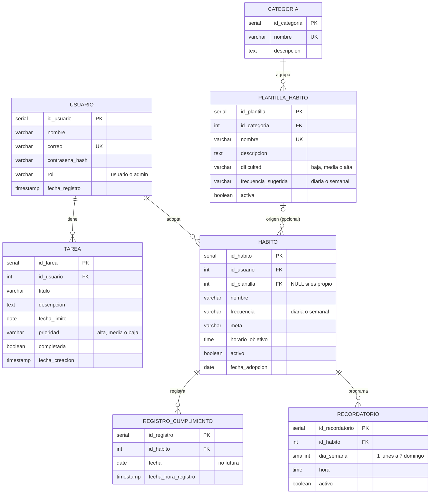

# GesHab — Backend (EP2)

API REST de la app de gestión de hábitos saludables y tareas, construida con
Node.js, Express y TypeScript sobre una base de datos PostgreSQL.

---

## Integrantes y responsabilidades

| Integrante | Rol | Responsabilidad |
|---|---|---|
| Ignacio Reyes Torres | A | Base de datos (`database/geshab.sql`) y documentación |
| Gabriel Martínez Oyarce | B | Servidor, autenticación JWT y seguridad |
| Matías Labra Concha | C | CRUD de usuario (tareas, hábitos, progreso) y pruebas |
| Martín Díaz Valle | D | CRUD de administración e integración con el frontend |

---

## Requisitos previos

- Node.js 18 o superior
- PostgreSQL 14 o superior, con `psql` disponible en la terminal
- Git


---

## Instalación y configuración

Todos los comandos se ejecutan desde la carpeta `backend/`.

### 1. Clonar el repositorio en la rama `backend`

```bash
git clone -b backend https://github.com/Klonmah/ing-web-gestion-habitos.git
cd ing-web-gestion-habitos/backend
```

### 2. Crear la base de datos

El script crea la base `geshab` desde cero: tablas, claves, restricciones,
índices y datos de prueba. Si la base ya existe, la borra y la vuelve a
crear, por lo que se puede ejecutar las veces que sea necesario.

```bash
psql -U postgres -f database/geshab.sql
```

> En Windows, si `psql` no se reconoce, hay que agregar la carpeta `bin` de
> PostgreSQL (por ejemplo `C:\Program Files\PostgreSQL\18\bin`) a la variable
> de entorno `Path` y reiniciar la terminal.

### 3. Configurar las variables de entorno

Copiar el archivo de ejemplo y completar los valores locales:

```bash
cp .env.example .env
```

| Variable | Descripción | Ejemplo |
|---|---|---|
| `PORT` | Puerto del servidor | `3000` |
| `DB_HOST` | Host de PostgreSQL | `localhost` |
| `DB_PORT` | Puerto de PostgreSQL | `5432` |
| `DB_NAME` | Nombre de la base | `geshab` |
| `DB_USER` | Usuario de PostgreSQL | `postgres` |
| `DB_PASSWORD` | Contraseña de ese usuario | — |
| `JWT_SECRET` | Clave de firma de los tokens (larga y aleatoria) | — |
| `JWT_EXPIRES_IN` | Duración del token (RNF-02) | `24h` |
| `CORS_ORIGIN` | Origen permitido del frontend | `http://localhost:8100` |

El archivo `.env` está en `.gitignore` y **nunca** se sube al repositorio.
Cada integrante crea el suyo con su propia contraseña de PostgreSQL.

Para generar un `JWT_SECRET`:

```bash
node -e "console.log(require('crypto').randomBytes(32).toString('hex'))"
```

### 4. Instalar dependencias

```bash
npm install
```

---

## Ejecución

```bash
npm run dev
```

El servidor queda en `http://localhost:3000`. Para revisar que esté conectado a la base se puede abrir `http://localhost:3000/salud`, que debería responder `"estado": "ok"`.

### Endpoints

Todas las rutas empiezan con `/api`. Las que dicen Usuario o Admin necesitan el token que devuelve el login, enviado en el header `Authorization: Bearer <token>`.

| Método | Ruta | Acceso | Qué hace |
|---|---|---|---|
| POST | `/api/auth/registro` | Público | Crea una cuenta nueva (siempre con rol usuario) |
| POST | `/api/auth/login` | Público | Inicia sesión y devuelve el token |
| GET | `/api/auth/perfil` | Usuario | Datos del usuario que inició sesión |
| GET, POST | `/api/tareas` | Usuario | Listar y crear tareas (RF-01) |
| PUT, DELETE | `/api/tareas/:id` | Usuario | Editar y borrar una tarea |
| GET, POST | `/api/habitos` | Usuario | Listar y crear hábitos (RF-02) |
| PUT, DELETE | `/api/habitos/:id` | Usuario | Editar y borrar un hábito |
| POST | `/api/habitos/:id/cumplimientos` | Usuario | Marcar un hábito como cumplido (RF-03) |
| GET, POST | `/api/registros` | Usuario | Listar y crear registros de cumplimiento |
| PUT, DELETE | `/api/registros/:id` | Usuario | Editar y borrar un registro |
| GET | `/api/progreso?periodo=semanal` | Usuario | Porcentaje de cumplimiento y rachas (RF-04). También acepta `mensual` |
| GET | `/api/catalogo?categoria=&dificultad=` | Usuario | Plantillas activas con filtros (RF-06) |
| GET, POST | `/api/admin/plantillas` | Admin | Listar y crear plantillas (RF-07) |
| PUT, DELETE | `/api/admin/plantillas/:id` | Admin | Editar y borrar plantillas (no se puede borrar si alguien la adoptó) |
| GET, POST | `/api/admin/categorias` | Admin | Listar y crear categorías (RF-08) |
| PUT, DELETE | `/api/admin/categorias/:id` | Admin | Editar y borrar categorías |
| GET | `/api/admin/metricas` | Admin | Métricas generales sin datos personales (RF-08) |

Si no se manda el token la respuesta es 401, y si un usuario normal intenta entrar a `/api/admin` la respuesta es 403.

Para levantar también el frontend, en otra terminal y en la rama `frontend`:

```bash
npm install
ionic serve
```


---

## Usuarios de prueba

Los crea `database/geshab.sql`. **Solo para desarrollo.**

| Correo | Contraseña | Rol |
|---|---|---|
| admin@geshab.cl | Admin1234 | admin |
| ana@geshab.cl | Usuario123 | usuario |
| benja@geshab.cl | Usuario123 | usuario |
| carla@geshab.cl | Usuario123 | usuario |

---

## Modelo relacional




### Relaciones

| Relación | Tipo | Qué pasa si se borra el padre |
|---|---|---|
| usuario → tarea | 1 a N | CASCADE |
| usuario → habito | 1 a N | CASCADE |
| categoria → plantilla_habito | 1 a N | RESTRICT |
| plantilla_habito → habito | 1 a N (opcional) | RESTRICT |
| habito → registro_cumplimiento | 1 a N | CASCADE |
| habito → recordatorio | 1 a N | CASCADE |

Usamos CASCADE en lo que es de cada usuario: si se borra una cuenta, se borran también sus tareas, hábitos, cumplimientos y recordatorios, ya que ya no le serviríoa a nadie más.

Usamos RESTRICT en el catálogo, así la base no deja borrar una plantilla que algún usuario ya adoptó (esto es lo que pide RF-07), ni una categoría que todavía tenga plantillas.

En `habito`, la columna `id_plantilla` puede ser NULL. Si el hábito viene del catálogo apunta a su plantilla, y si el usuario lo creó desde cero queda en NULL. Así los dos casos de RF-02 caben en una sola tabla.

### Restricciones

- El correo de cada usuario es único y tiene que tener formato de correo.
- El rol solo puede ser `usuario` o `admin`, y por defecto es `usuario`.
- Un usuario no puede adoptar dos veces la misma plantilla.
- Un hábito no se puede marcar dos veces el mismo día. Esto evita que alguien infle su racha.
- La fecha de un cumplimiento no puede ser futura.
- En los recordatorios, `dia_semana` va de 1 (lunes) a 7 (domingo).
- La racha no se guarda en ninguna tabla, el backend la calcula con los registros de cumplimiento.

### Índices

Para cumplir RNF-01 (que los hábitos del día carguen en menos de 2 segundos) agregamos índices en las columnas que más se usan para filtrar:

- `tarea (id_usuario)`
- `habito (id_usuario)`
- `registro_cumplimiento (id_habito, fecha DESC)`
- `plantilla_habito (id_categoria)`
- `recordatorio (dia_semana, hora)`, solo para los recordatorios activos

### Pruebas de las restricciones

Al final de `database/geshab.sql` dejamos comentadas cuatro pruebas para correr a mano en `psql`. Las tres primeras tienen que dar error:

| Prueba | Qué debería pasar |
|---|---|
| Marcar dos veces el mismo hábito el mismo día | Error por el UNIQUE |
| Borrar una plantilla que alguien adoptó | Error por la clave foránea (RF-07) |
| Crear una tarea con prioridad `urgente` | Error por el CHECK |
| Borrar un usuario | Se borran sus datos y el catálogo queda igual |

## Estructura

```text
backend/
├── database/
│   └── geshab.sql        script de la base de datos
├── src/
│   ├── config/db.ts      conexión a PostgreSQL
│   ├── routes/           rutas de la API
│   ├── controllers/      reciben las peticiones y responden
│   ├── services/         lógica y consultas SQL
│   ├── middlewares/      JWT, rol admin, validación y errores
│   ├── schemas/          validaciones con zod
│   ├── types/
│   ├── utils/
│   └── index.ts          arranque del servidor
├── .env.example
├── .gitignore
├── package.json
├── tsconfig.json
└── README.md
```

## Evidencia Colecciones Postman

Las colecciones de Postman en formato .json y las capturas de pantallas de distintas instancias de envío de peticiones se pueden encontrar en la carpeta 'anexos'.
