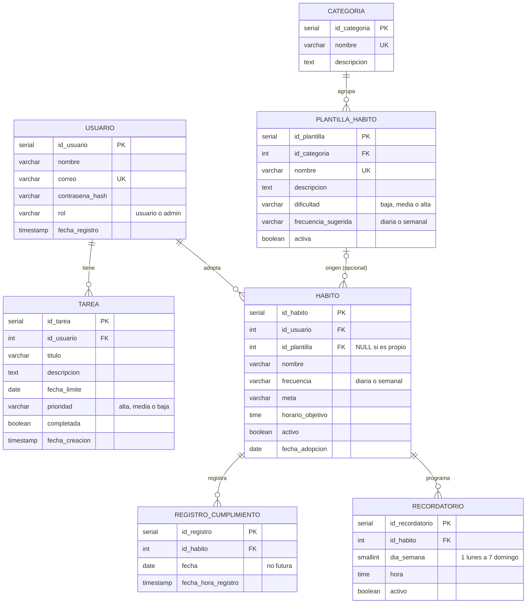

# GesHab — Backend (EP2)

API REST de la app de gestión de hábitos saludables y tareas, construida con
Node.js, Express y TypeScript sobre una base de datos PostgreSQL.

---

## Integrantes y responsabilidades

| Integrante | Rol | Responsabilidad |
|---|---|---|
| Ignacio Reyes Torres | A | Base de datos (`database/geshab.sql`) y documentación |
| Gabriel Martínez Oyarce | B | Servidor, autenticación JWT y seguridad |
| Matías Labra Concha | C | CRUD de usuario (tareas, hábitos, progreso) y pruebas |
| Martín Díaz Valle | D | CRUD de administración e integración con el frontend |

---

## Requisitos previos

- Node.js 18 o superior
- PostgreSQL 14 o superior, con `psql` disponible en la terminal
- Git


---

## Instalación y configuración

Todos los comandos se ejecutan desde la carpeta `backend/`.

### 1. Clonar el repositorio en la rama `backend`

```bash
git clone -b backend https://github.com/Klonmah/ing-web-gestion-habitos.git
cd ing-web-gestion-habitos/backend
```

### 2. Crear la base de datos

El script crea la base `geshab` desde cero: tablas, claves, restricciones,
índices y datos de prueba. Si la base ya existe, la borra y la vuelve a
crear, por lo que se puede ejecutar las veces que sea necesario.

```bash
psql -U postgres -f database/geshab.sql
```

> En Windows, si `psql` no se reconoce, hay que agregar la carpeta `bin` de
> PostgreSQL (por ejemplo `C:\Program Files\PostgreSQL\18\bin`) a la variable
> de entorno `Path` y reiniciar la terminal.

### 3. Configurar las variables de entorno

Copiar el archivo de ejemplo y completar los valores locales:

```bash
cp .env.example .env
```

| Variable | Descripción | Ejemplo |
|---|---|---|
| `PORT` | Puerto del servidor | `3000` |
| `DB_HOST` | Host de PostgreSQL | `localhost` |
| `DB_PORT` | Puerto de PostgreSQL | `5432` |
| `DB_NAME` | Nombre de la base | `geshab` |
| `DB_USER` | Usuario de PostgreSQL | `postgres` |
| `DB_PASSWORD` | Contraseña de ese usuario | — |
| `JWT_SECRET` | Clave de firma de los tokens (larga y aleatoria) | — |
| `JWT_EXPIRES_IN` | Duración del token (RNF-02) | `24h` |
| `CORS_ORIGIN` | Origen permitido del frontend | `http://localhost:8100` |

El archivo `.env` está en `.gitignore` y **nunca** se sube al repositorio.
Cada integrante crea el suyo con su propia contraseña de PostgreSQL.

Para generar un `JWT_SECRET`:

```bash
node -e "console.log(require('crypto').randomBytes(32).toString('hex'))"
```

### 4. Instalar dependencias

```bash
npm install
```

---

## Ejecución

```bash
npm run dev
```

La API queda disponible en `http://localhost:3000`.

Para levantar también el frontend, en otra terminal y en la rama `frontend`:

```bash
npm install
ionic serve
```


---

## Usuarios de prueba

Los crea `database/geshab.sql`. **Solo para desarrollo.**

| Correo | Contraseña | Rol |
|---|---|---|
| admin@geshab.cl | Admin1234 | admin |
| ana@geshab.cl | Usuario123 | usuario |
| benja@geshab.cl | Usuario123 | usuario |
| carla@geshab.cl | Usuario123 | usuario |

---

## Modelo relacional

